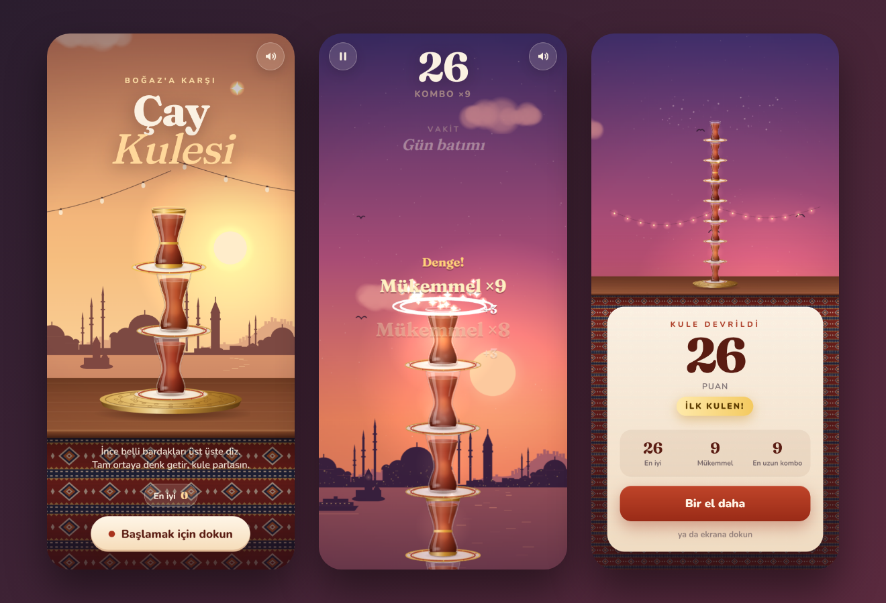

# Çay Kulesi — Tea Tower

A one-thumb stacking game set on a tea terrace facing the Bosphorus. A brass tea hanger swings a tulip-shaped Turkish tea glass back and forth above your tower. Tap to drop it. Land it dead center and the glass flashes, your combo climbs a Hicaz scale, and the tower straightens. Land it off center and the tower starts to lean. Lean too far and the whole thing comes down.

**Play:** https://ardazeybek-dev.github.io/tea-tower/



## How to play

- **Tap anywhere** (or press Space) when the swinging glass is over the top of the tower.
- **Perfect** drops (dead center) score +2 and build a combo. Three or more in a row also pull the tower back toward vertical.
- Off-center drops shift the tower's center of mass. If the weight above any glass hangs past the rim, that part of the tower topples.
- **Gilded glasses** are worth extra. A perfect drop on one gives +5.
- Every 7 glasses the time of day moves on: afternoon, sunset, night, dawn, morning, noon. The swing gets faster and wider as you climb, and from glass 10 the hanger starts to drift.
- `P` / `Esc` pauses and `M` mutes. The game also pauses on its own when the tab is hidden.

## Modes and progression

- **Second chance:** after a good run (score at least 10 and at least half of your best) the game-over sheet offers one revive per run. The fallen glasses are cleared, the rest of the tower is straightened a little and the score is kept. On the portal builds this is a rewarded ad. On GitHub Pages it is free. While it is offered, tapping the screen does nothing, so a stray tap never throws it away.
- **Daily tea:** one run type per calendar day (local time), the same for everyone. It has a daily rule (windy hanger, hasty swing, golden hour, wide swing or southwester), a seeded glass sequence and a starting time of day. It keeps its own best score for the day and a streak of consecutive days. Second chance is off in this mode.
- **Glass collection:** every glass you stack counts toward a lifetime total that unlocks new designs at 30, 80, 160, 300 and 500: fluted, tulip, evil eye, silver and cobalt. Pick one under *Glasses* on the title screen. Gilded bonus glasses always keep their gold look. Any of them can also be bought early with sugar, and three more (emerald, ruby, pearl) are sugar only.
- **Sugar:** the in-game currency. Every glass stacked gives 1, a perfect drop +1 and a gilded glass +2, credited as you play. Gifts, the wheel, missions and achievements pay sugar too.
- **Gifts:** a 7-day login streak (20, 30, 40, 60, 80, 100, 150 sugar; a missed day starts over) and a daily wheel with one free spin. On the portal builds a rewarded ad gives one extra spin. The panel opens by itself on the first visit of the day.
- **Missions:** three daily missions picked from the date (stack, perfects, height, combo, gilded, runs, Daily tea), two weekly goals (300 glasses, play on 5 different days; the week starts on Monday) and 20 permanent achievements. All of them pay sugar the moment they are done.
- **Goals during a run:** a dashed line on the tower marks your highest tower so far, and passing it gets a short celebration. Every 25 glasses in one run is a milestone worth 10, 20, 30… sugar.
- **Game over:** when you fall just short, the sheet says how many points you needed for your best. It also shows a progress bar toward the next glass or place, and the bar fills by what this run added.
- **Streak repair:** if you missed exactly one day, the gift panel lets you save the gift streak or the Daily tea streak with sugar (40 + 10 per day, at most 150).
- **Places:** four backdrops for the same tea terrace: Bosphorus (Üsküdar shore, ferry and Maiden's Tower), Rize (tea garden hills, drifting mist, birdsong), Cappadocia (fairy chimneys, Uçhisar and hot-air balloons) and Bodrum (white houses, windmills, the castle and a gulet). Rize, Cappadocia and Bodrum unlock at 120, 260 and 450 glasses, or earlier with sugar (300, 550, 850). Pick one under *Collection → Places*. Places only change the look and the ambience. The rules, the swing and Daily tea are the same everywhere.
- **Settings:** the slider button on the title screen or *Settings* in the pause menu. Sound effects and ambience switch separately (the speaker button still mutes everything), vibration can be turned off where the device supports it, the tutorial can be shown again, and graphics run in *Auto* (adaptive resolution), *High* (sharper on high-DPI screens, still drops resolution if the frame rate falls) or *Battery saver* (lower resolution, fewer particles, stars and sea glints).
- **Share:** the game-over sheet shares the score with the Web Share API, or copies it to the clipboard. It is hidden on the portal builds.

## Features

- Canvas2D renderer with no build step and no dependencies. Every sprite (glasses, saucers, brass tray, kilim tablecloth, the four place skylines) is drawn in code and cached once per resolution. Only the active place is built; switching rebuilds it once, never during a run.
- Places are drawn in three depth layers with baked shading and texture. Per time of day they are merged into one horizon image: sun-side rim light, soft shadow side, aerial haze that fades far layers into the sky, a horizon mist band, and water with a broken reflection and wave bands (or a valley floor). The merge reruns only when the colors change, at most 12 times per time-of-day transition.
- All audio is synthesized with WebAudio: glass clinks, perfect-drop notes that rise along the Hicaz scale, and an ambience per place (sea and seagulls, or wind and birdsong) on its own channel.
- Installable PWA that works offline (manifest + service worker), with high-DPI rendering, safe-area insets and adaptive resolution. After the second run an *Add to home screen* button shows on the title screen and the game-over sheet. This happens only where the browser offers installation and never on the portal builds.
- Layouts for small phones, landscape phones and tablets. Every touch target is at least 44 px. The title screen draws at 30 fps and the pause screen at 10 fps to save battery.
- A terrace in the foreground: grape vines in the top corners sway in the breeze. Clouds are flat and layered with shaded undersides. The glasses reflect the color of the sky, and at sunset and dawn a shaft of light with drifting dust falls on the table. Glasses outside the view are not drawn.
- Best score, daily best and streak, lifetime glass count, chosen design, sugar, owned designs, gift streak, wheel spins, missions, achievements, stats, the chosen and bought places (`ck_venue`, `ck_vowned`), weekly goals (`ck_week`), the run count and install choice (`ck_runs`, `ck_inst`) and settings (`ck_set`) are saved in `localStorage` (`ck_*` keys).

## Run locally

```bash
git clone https://github.com/ardazeybek-dev/tea-tower.git
cd tea-tower
python -m http.server 8080 --directory docs
# open http://localhost:8080
```

The page must be served over http(s). Opening `index.html` as a file is not enough, because the service worker and fonts need an origin. No environment variables are required.

## Portal builds

`platform/build.py` generates portal copies from `docs/` without changing it: SDK hooks (gameplay start/stop, an ad break between game over and the next run with audio muted, a rewarded ad for the second chance), English UI by default (Turkish when the browser language is Turkish), and no service worker, manifest or absolute links.

```bash
python platform/build.py                                   # platform/crazygames/ and platform/gamedistribution/
python platform/build.py gamedistribution --gd-id <ID>     # GameDistribution needs the game ID from its panel
python platform/build.py --zip ../dist                     # also write upload-ready zips (index.html at the root)
```

Edit the game in `docs/` and the adapter in `platform/src/platform.js`, then rebuild; never edit the generated folders. The reward is granted only after the ad has been watched to the end (CrazyGames `adFinished`, GameDistribution `SDK_REWARDED_WATCH_COMPLETE`). When a revive is offered and the player restarts instead, no midgame ad is shown for that restart. GameDistribution only serves rewarded ads after the rewarded flag is enabled for the game in its developer panel. `?pf_minplay=0` skips the 60-second delay before the first ad (testing only).

## Project structure

```
docs/                 GitHub Pages root (main branch, /docs)
  index.html          markup, meta / Open Graph tags
  style.css           UI overlays (title, HUD, pause, game over)
  game.js             engine: sprites, physics, camera, effects, audio
  sw.js               offline cache (bump CACHE when shipping changes)
  manifest.webmanifest
  fonts/              Fraunces + Nunito (OFL), latin + latin-ext subsets
  icons/              app icons (any + maskable)
  og.png, preview.png
platform/
  build.py            builds portal copies from docs/
  src/platform.js     portal adapter (SDK calls, ad break, language)
  crazygames/, gamedistribution/   generated output, do not edit
```

## Gotchas

- Changes not showing after deploy → the service worker serves cached assets → bump `CACHE` in `docs/sw.js` (install fetches with `cache: 'reload'` so the new cache never stores HTTP-cached old files).
- Headless timings or tests are unreliable → software rasterization, rAF throttled to ~1 fps in a background page, adaptive resolution silently drops DPR, ±20 % noise between runs → drive gameplay with `window.__game.setTimeScale(0)` plus `step()`, `aimPerfect()`, `aimOffset(x)`; for speed call `page.bringToFront()`, set `window.__fixDpr = 1` before load, read `window.__game.perf()` and compare old and new builds in alternating runs (median) with a ~12-glass tower and a time-of-day transition (an empty tower hides per-glass and re-tint costs), never against a number from another day.
- `build.py` stops with "expected 1 match" → a line it patches in `docs/game.js` changed → update the matching `sub1` call in `build.py`.
- Portal SDK logs "gameplayStart() call throttled" in tests → start/stop closer than 1 s → leave real time between rounds.
- Shading baked into a backdrop mask disappears → `tinted()` repaints every pixel with one color → keep shading in a place layer's RGB (white = full color) and let `composeHorizon()` multiply it; use `tinted()` only for flat shapes.

Fonts: Fraunces and Nunito, SIL Open Font License (see `docs/fonts/`).
